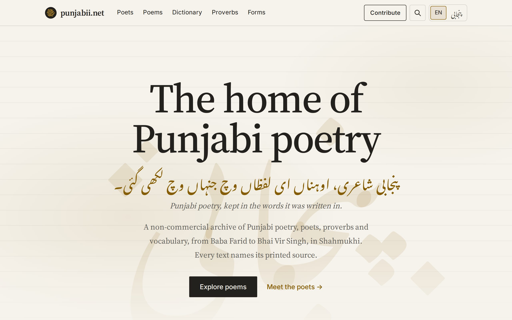
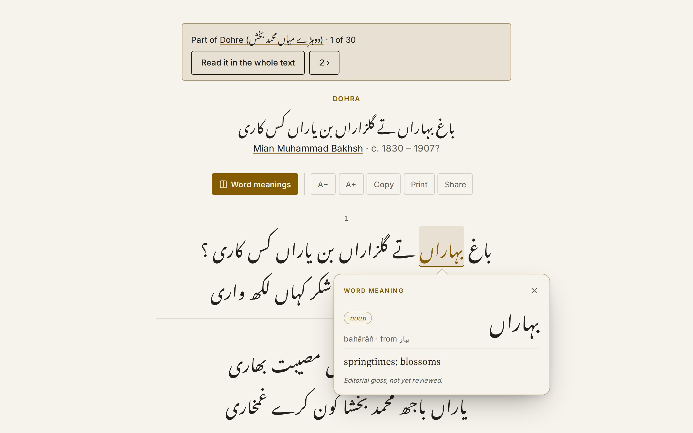
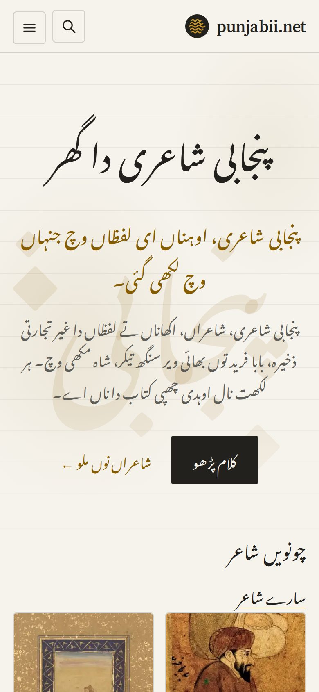
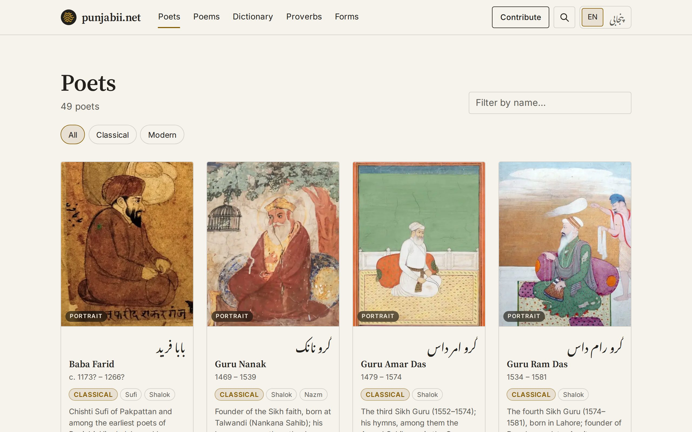

<div align="center">


# punjabii.net

### پنجابی شاعری دا گھر · The home of Punjabi poetry

A non-commercial archive of Punjabi poetry, poets, proverbs and vocabulary,<br>
kept in Shahmukhi, the script it was written in.

**[punjabii.net](https://punjabii.net)** · [پنجابی](https://punjabii.net/pa) · [Instagram](https://www.instagram.com/punjabiidotnet/)

<br>

| 6,177 poems | 49 poets | 62 complete works | 553 dictionary words | 159 proverbs |
|:---:|:---:|:---:|:---:|:---:|

</div>

<br>



## What it is

From Baba Farid's shaloks in the 13th century to Bhai Vir Singh in the 20th, Punjabi poetry has a long
written tradition, but most of it is hard to read online: scattered scans, Gurmukhi-only editions,
copy-pasted text with no source. punjabii.net gathers it in one place, in Shahmukhi, set in Nastaliq,
with the source of every text named on its page.

- **Complete works, not excerpts.** Heer Waris Shah, Saif-ul-Malook, the kafis of Bulleh Shah and Shah
  Hussain, the abyat of Sultan Bahu and the shaloks of Baba Farid are here whole, readable part by part
  or as one text.
- **The meaning of every word.** Tap or hover any word in any poem for its meaning, part of speech,
  transliteration and root.
- **Two interfaces.** Every page exists in English and in Punjabi (`/pa`), and the Punjabi side is
  Shahmukhi throughout: menus, poet biographies, word meanings and search.
- **Sources first.** Each poem says where its text comes from. Texts are public-domain transcriptions,
  mostly from Wikisource, and the poets whose work is still in copyright are kept out until permission
  is arranged (see [`held/`](held/README.md)).
- **Open to readers and machines.** Everything is plain static HTML with a sitemap, `llms.txt` and
  structured data, so search engines and AI assistants can read and cite it.

<table>
<tr>
<td width="62%"></td>
<td width="38%"></td>
</tr>
<tr>
<td align="center"><sub>A dohra by Mian Muhammad Bakhsh, with the meaning card open on بہاراں</sub></td>
<td align="center"><sub>The Punjabi interface on a phone</sub></td>
</tr>
</table>

## In the archive

| Poet | | Poems |
|---|---|---:|
| Damodar | دمودر | 956 |
| Waris Shah | وارث شاہ | 631 |
| Ali Haider Multani | علی حیدر ملتانی | 483 |
| Dhani Ram Chatrik | دھنی رام چاترک | 383 |
| Khwaja Ghulam Farid | خواجہ غلام فرید | 345 |
| Baba Farid | بابا فرید | 329 |
| Guru Nanak | گرو نانک | 244 |
| Hashim Shah | ہاشم شاہ | 227 |
| Bulleh Shah | بلھے شاہ | 220 |
| Sultan Bahu | سلطان باہو | 212 |

…and 39 more, across the forms of the tradition: qissa, kafi, nazm, shalok, dohra, var, bait and siharfi.



## How it's built

A static [Astro](https://astro.build) site. The content is Markdown and JSON in the repo, and the Git
history is the editorial record: every change to a text is a commit.

| | |
|---|---|
| **Content** | `src/content/`: poems, poets, works, dictionary, proverbs, forms and word glosses, with schemas in `src/content.config.ts` |
| **Pages** | `src/pages/`: English at `/`, Punjabi at `/pa`, one URL per page, no trailing slashes |
| **Search** | [Pagefind](https://pagefind.app), built at deploy time, no server |
| **Fonts** | Nastaliq and serif faces, subset and self-hosted (`npm run fonts`) |
| **Contributions** | A Cloudflare Pages Function (`functions/api/contribute.ts`) stores messages in Workers KV |
| **Hosting** | Cloudflare Pages (Free plan; the build stays under its 20,000-file limit) |
| **Import** | `scripts/import/`: fetchers and converters for the public-domain sources |

## Run it locally

Needs Node 22 or newer (the build is tested with the version in `.node-version`).

```sh
npm install
npm run dev        # http://localhost:4321
npm run build      # astro check + build + Pagefind index into dist/
npm test           # contribution Function tests
npm run fonts      # re-subset the self-hosted fonts
PN_FIXTURES=1 npm run dev   # also load layout placeholders from src/content/_fixtures
```

## Contributing

Corrections matter most: a misspelled word, a missing verse, a wrong attribution. Use the
[contribution form](https://punjabii.net/contribute) on the site, or open an issue or pull request here
with the poem's address and the source you are checking against.

## Project notes

| File | What's in it |
|---|---|
| [`DEPLOY.md`](DEPLOY.md) | Cloudflare Pages setup and contribution-form storage |
| [`LAUNCH.md`](LAUNCH.md) | Go-live checklist: DNS, redirects, bot settings, search consoles |
| [`CHANGELOG.md`](CHANGELOG.md) | What each phase built and what is left |
| [`PARITY.md`](PARITY.md) | Feature checklist against pushto.net, the Pashto archive this site is modelled on |
| [`docs/wireframes/`](docs/wireframes) | Sketches of every screen |
| [`social/instagram/`](social/instagram) | The tools behind the [@punjabiidotnet](https://www.instagram.com/punjabiidotnet/) reels |

<br>

<div align="center">
<sub>A non-commercial project. The poems are in the public domain; the poets belong to everyone who reads them.</sub>
</div>
